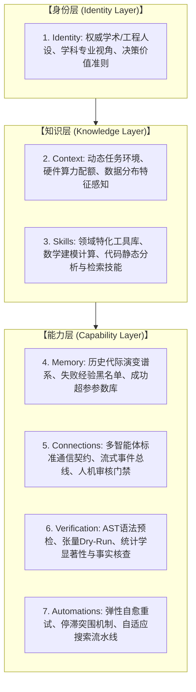
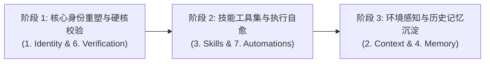

# Science4Me 智能体七层能力增强架构方案 (Agent Enhancement Specification)

本文档制定了 `Science4Me` 全套智能体的客制化能力增强架构，采用标准的七层智能体工程模型（身份层、知识层、能力层），用于指导系统各 Agent 从初级提示词调用走向具备防御性、记忆沉淀、硬件感知与闭环自愈能力的高级智能体。

---

## 一、 七层增强模型总览

```
┌─ 7. Automations    自动化 ──┐
├─ 6. Verification   校验      │
├─ 5. Connections    连接      │  能力层 (Capabilities)
├─ 4. Memory         记忆      │
├─ 3. Skills         技能      │
├─ 2. Context        上下文    │  知识层 (Knowledge)
└─ 1. Identity       身份 ────┘  身份层 (Identity)
```



---

## 二、 核心演进闭环四大智能体增强方案

### 1. GoalArchitectureAgent（选题与目标架构智能体）
- **对应代码**：`science4me/agents/goal_architecture.py`
- **核心定位**：全自动科研探索的“总设计师”，负责确立课题、设定量化终止目标（Stopping Criteria）与梯队演进规划。

| 层级 | 增强设计规范与落地细节 |
| :--- | :--- |
| **1. Identity (身份)** | **首席 AI 科学家兼科研战略总监**：具备敏锐的学术鉴赏力与严谨的科学怀疑态度。杜绝“无意义的拼接式灌水”，专注于提炼具有核心理论挑战和落地价值的真问题。 |
| **2. Context (上下文)** | **动态计算资源与学术环境感知**：注入当前计算配额（如单卡 24G 显存/单轮 5 分钟限制）、近 3 年顶级会议（NeurIPS/ICLR/CVPR）前沿研究痛点、目标顶级期刊/会议风格偏好。 |
| **3. Skills (技能)** | **学术文献深度挖掘技能**：<br>① 检索关键词动态衍生与分词检索算法；<br>② SOTA 基准线提取（从文献 Abstract 自动解析现有最高性能指标作为对标基线）；<br>③ 课题创新度与可执行度自测打分。 |
| **4. Memory (记忆)** | **历史立项与演进策略库**：持久化记录历史所有已探索过的课题方向与最终收敛效果，建立课题指纹，防止相似思路重复立项，复用高收敛性的架构设计模板。 |
| **5. Connections (连接)** | **标准化终止协议管道**：标准化输出 `TargetGoalContract` 协议（包含量化指标、阈值、判定方向、物理意义），并对接【人工审核门禁 1】，支持人类学者在 Web UI 调整终止条件。 |
| **6. Verification (校验)** | **目标合理性与理论自洽性预检**：<br>① 自动校验量化指标是否符合物理实际（避免设定 99.99% 等不可达成目标）；<br>② 校验架构设计是否存在逻辑悖论（如特征维度不连续、前后层不匹配）。 |
| **7. Automations (自动化)** | **文献降噪与演进时间线自动推导**：自动剔除相关度低的边缘文献；根据技术瓶颈自动推导出 Gen 1（基线稳定）-> Gen 2（自适应调制）-> Gen 3（深层解耦）的递进路线。 |

---

### 2. ExperimentPlannerAgent（实验方案规划智能体）
- **对应代码**：`science4me/agents/experiment_planner.py`
- **核心定位**：实验协议与评测方案的“严谨把关人”，确保实验具有统计学意义与可复现性。

| 层级 | 增强设计规范与落地细节 |
| :--- | :--- |
| **1. Identity (身份)** | **资深实验设计架构师**：恪守“单一变量原则”（Control Variate Principle），对基线对比（Baselines）、消融实验（Ablations）和统计学显著性有严苛要求。 |
| **2. Context (上下文)** | **数据特征与硬件约束上下文**：感知当前任务的数据维度、类别不平衡比率、计算平台（GPU 显存上限），并根据资源自动圈定实验规模。 |
| **3. Skills (技能)** | **专业实验策略生成技能**：<br>① 自动配置自适应学习率调度（CosineAnnealing / Warmup）；<br>② 自动设计严谨的消融对照组方案；<br>③ 丰富评估指标（引入 F1-Score、AUC、FLOPs、收敛轮数等）。 |
| **4. Memory (记忆)** | **超参数经验库（Hyperparameter Knowledge Base）**：沉淀历史同类网络结构在不同特征规模下的最优学习率区间、权重衰减及 Batch Size 经验。 |
| **5. Connections (连接)** | **承上启下参数流**：输入消费 Agent 1 的架构目标，输出标准化的 `ExperimentSpec` 对象，向【人工审核门禁 2】与下游训练智能体提供参数。 |
| **6. Verification (校验)** | **实验完备性静态审查**：自动校验对照组设置是否真正对齐无关变量，核查评估指标是否全覆盖核心停止目标。 |
| **7. Automations (自动化)** | **超参数自适应边界计算**：根据数据量大小自动计算最合理的 `epochs` 与 `batch_size`，防止配置过大引发显存溢出（OOM）或配置过小导致欠拟合。 |

---

### 3. ExecutionTrainingAgent（代码执行与训练智能体）
- **对应代码**：`science4me/agents/execution_training.py`
- **核心定位**：全自动科研的代码引擎，负责高性能、高稳健的 PyTorch 代码构建与沙箱真实训练。

| 层级 | 增强设计规范与落地细节 |
| :--- | :--- |
| **1. Identity (身份)** | **高性能计算与防御性代码架构师**：极致追求硬件算力压榨（CUDA/AMP）、数值计算稳定性与 100% 运行稳健性，严厉杜绝训练静默崩溃与 NaN 溢出。 |
| **2. Context (上下文)** | **物理运行时环境感知**：实时探测底层设备（GPU 型号、驱动版本、CUDA 可用性、可用显存、CPU 核心数），动态生成匹配当前算力的代码。 |
| **3. Skills (技能)** | **工程加速与物理持久化技能库**：<br>① 自动集成混合精度加速（`torch.cuda.amp`）；<br>② 自动配置梯度裁剪（`clip_grad_norm_`）；<br>③ 权重管理技能（最佳权重与最新 Checkpoint 序列化落盘）；<br>④ 训练进度流式埋点监控。 |
| **4. Memory (记忆)** | **错误与自愈经验记忆（Error-Patch Memory）**：建立历史报错与修复方案索引库，记录 CUDA OOM、维度不匹配等常见报错的有效修复 Patch，实现秒级经验复用。 |
| **5. Connections (连接)** | **实时事件总线（Event Stream）**：通过流式回调和 WebSocket 向上层 Web 控制台与演进历史管理器实时广播 Epoch 级 Loss、指标曲线与硬件负载。 |
| **6. Verification (校验)** | **执行前两道质量防线**：<br>① **代码 AST 语法静态预检**（检查未导包、未定义变量、非法语法）；<br>② **虚拟张量干跑（Dry-Run）**：用虚拟 Tensor 执行 1 个 step，确保前向传播、损失计算与反向传播维度完全贯通后再启动全量训练。 |
| **7. Automations (自动化)** | **自愈式弹性执行流水线**：遭遇显存不足自动减半 Batch Size 重试；检测到 Loss 出现 NaN 自动降低学习率自愈重启；超时自动保护性阻断。 |

---

### 4. OptimizationDiagnosisAgent（诊断与演进优化智能体）
- **对应代码**：`science4me/agents/optimization_diagnosis.py`
- **核心定位**：演进闭环的“诊断医师与进化推进器”，负责精准归因、停滞突破与架构变异。

| 层级 | 增强设计规范与落地细节 |
| :--- | :--- |
| **1. Identity (身份)** | **模型因果诊断与进化算法专家**：精通训练动力学，擅长通过损失收敛斜率、泛化误差差距精准归因出模型内在瓶颈。 |
| **2. Context (上下文)** | **全局演变拓扑图感知**：掌握全代际演变曲线与多代提升斜率，判断优化是处于“快速上升期”、“收益递减期”还是“平台停滞期”。 |
| **3. Skills (技能)** | **深层动力学诊断工具箱**：<br>① 梯度消失/爆炸量化分析器；<br>② 欠拟合/过拟合量化判定（基于 Train-Test 偏离度）；<br>③ 架构演化变异算子库（残差注入、特征重标定、自注意力增强、门控机制）。 |
| **4. Memory (记忆)** | **已证伪假设黑名单与演化树记忆**：维护“已被证伪的结构与参数”黑名单，防止智能体在已证明无效的思路上反复尝试。 |
| **5. Connections (连接)** | **演进决策中枢**：与【人工审核门禁 3】深度连接，提供“渐进优化”与“颠覆重构”双方案供学者选择；达标时向系统发送终止事件。 |
| **6. Verification (校验)** | **改进因果闭环校验**：严格验证下一代架构提议是否在因果逻辑上直接针对当前诊断出的缺陷，避免无效变异。 |
| **7. Automations (自动化)** | **自适应停滞突围机制（Stagnation Breakout）**：当连续 2 代指标提升幅度低于阈值时，自动触发“突围模式”，强制切换架构范式或损失函数形式以跳出局部最优。 |

---

## 三、 全流程学术产出智能体增强方案

### 5. VisualizerAgent（学术制图与统计表格智能体）
- **对应代码**：`science4me/agents/visualizer.py`
- **1. Identity**：顶级期刊艺术总监与数据可视化专家（精通 Nature / IEEE Transactions 审美规范与色彩心理学）。
- **2. Context**：感知指标数据的物理维度、离散度与模型代际关系。
- **3. Skills**：
  - 新增混淆矩阵热力图、ROC-AUC 曲线绘制；
  - 参数量-精度 Pareto 前沿气泡图；
  - LaTeX 三线表自动排版（最优指标粗体、次优指标下划线标记）。
- **4. Memory**：统一配色方案与字体规范库，确保单篇论文内所有插图色系风格严格一致。
- **5. Connections**：输出高质量矢量图（PDF/PNG）与 LaTeX 片段，写入导出目录并通知 WriterAgent。
- **6. Verification**：图像分辨率静态校验（强制 >= 300 DPI）、坐标轴标签物理量纲校验、LaTeX 表格代码语法检查。
- **7. Automations**：根据指标数量自动选择单栏或双栏绘图布局，异常极端值自动标记并平滑显示。

---

### 6. WriterAgent（学术论文撰写与排版智能体）
- **对应代码**：`science4me/agents/writer.py`
- **1. Identity**：资深 AI 学术主笔与顶级会议审稿人（行文精炼、逻辑严密、论证自洽，杜绝套话）。
- **2. Context**：注入完整实验指标数据快照、图表路径清单、文献 BibTeX 与审稿人修改意见。
- **3. Skills**：
  - LaTeX 数学公式严谨推导与符号系统化表达；
  - 模块化论文分段撰写与整体结构拼装；
  - BibTeX 文献交叉引用自动对齐与校验。
- **4. Memory**：经典论文论证结构模板库、高引用句式库、专业领域标准学术术语表。
- **5. Connections**：输出标准 Overleaf 兼容的 `.tex` 源码包、`references.bib` 与 Markdown 版本。
- **6. Verification**：**引用一致性审查**：核查正文中所有 `\cite{...}` 是否均在 BibTeX 库中存在；核查正文提及的图表编号是否真实存在。
- **7. Automations**：接收 Reviewer 审稿意见后，自动生成“逐条修改答复信（Response to Reviewers）”并驱动正文针对性重写。

---

### 7. ReviewerAgent（模拟顶会同行评审智能体）
- **对应代码**：`science4me/agents/reviewer.py`
- **1. Identity**：ICLR / NeurIPS 领域主席（Area Chair）与资深审稿专家（奉行高严谨度、批判性思维与科学求证原则）。
- **2. Context**：论文全篇内容、实验指标详情、大会评分细则（Soundness、Novelty、Empirical Rigor、Clarity）。
- **3. Skills**：实验充分度量化评估模型、学术硬伤识别器（检查是否过度夸大结论、是否存在潜在数据泄露）。
- **4. Memory**：顶级会议历史高频拒稿（Reject）原因知识库（如消融实验不足、与弱基线对比）。
- **5. Connections**：向 WriterAgent 输出结构化修改建议，向系统提交终审决策（Accept / Borderline / Reject）与综合打分。
- **6. Verification**：**防幻觉事实核查（Fact-Checking）**：核对论文正文声称的指标数值与代码真实产出的 `metrics.json` 是否完全吻合。
- **7. Automations**：综合分自动加权计算；若综合评分未达标（如 < 7.0），自动生成结构化修改待办清单，驱动迭代修正。

---

## 四、 落地实施推进路线 (Implementation Roadmap)



1. **第一阶段：核心身份重塑与硬核校验（强化 1. Identity & 6. Verification）**
   - 升级各个 Agent 的 `system_prompt`，赋予角色深度领域认知与防御性原则；
   - 在 `ExecutionTrainingAgent` 运行前增加 **AST 静态检查** 与 **Tensor 虚拟干跑（Dry-Run）**；
   - 在 `GoalArchitectureAgent` 增加量化目标合理性断言。

2. **第二阶段：技能工具集与自动化自愈（强化 3. Skills & 7. Automations）**
   - 在 `ExecutionTrainingAgent` 中加入混合精度加速（AMP）、显存溢出自适应减半 Batch Size 重试；
   - 在 `OptimizationDiagnosisAgent` 中落地“连续多代停滞突围机制”，实现颠覆性变异；
   - 在 `VisualizerAgent` 中补充混淆矩阵与 Pareto 前沿图。

3. **第三阶段：环境感知与历史记忆沉淀（强化 2. Context & 4. Memory）**
   - 将 `EvolutionHistoryManager` 扩展为多代演化树拓扑，记录失败假设黑名单与成功超参库；
   - 增加运行时硬件动态探测（显存、CUDA 核心），使生成的代码与规划的超参完美契合宿主机。
