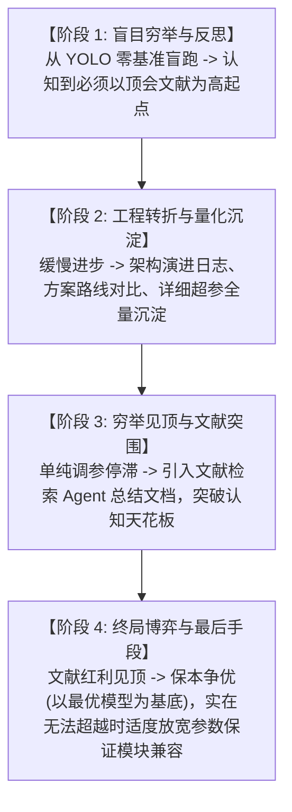

# Science4Me 科研心路历程与方法论演进 (Research Journey & Methodology)

本文档真实记录了在“工业检测轻量化模型”等实际科研与工程实验中所沉淀的核心心路历程、踩坑反思与自动化演进方法论，作为系统后续所有 Agent 流程复用与优化的基石哲学。

---

## 一、 实验心路历程的四大演进阶段

---

### 阶段 1：从“盲目穷举”到“文献高起点”
- **初识现象**：在最初定下“工业检测轻量化模型”课题后，直接在 YOLO 等经典模型上开始调参和训练，实验过程类似机械式穷举。
- **核心反思**：从零或仅凭直觉在低起点上穷举，不仅消耗大量算力，而且探索空间漫无目的。**正规科研绝不能搞无准备的盲目穷举，必须首先深入查阅顶级学术文献，总结现有 SOTA 的痛点与前沿解法，获取一个较高的理论起点来设计实验。**
- **系统实现映射**：
  - 对应 [`GoalArchitectureAgent`](science4me/agents/goal_architecture.py)（Agent 1）。
  - 在开始任何训练之前，强制先检索 ArXiv 文献，提炼前沿瓶颈与基线，确立量化停止目标与 Gen 1 架构，并通过【门禁 1】审核。

---

### 阶段 2：转折点——系统化实验记录与架构演进沉淀
- **初识现象**：穷举一段时间后虽有缓慢成果，但进步非常吃力，模型性能不够突出，学术创新点与理论支撑严重不足。
- **核心转折点（Turning Point）**：
  1. **记录架构演进历史**：详细记录每一次结构调整（加了什么层、改了什么激活函数、维度如何变化）。
  2. **沉淀方案路线文档**：确立清晰的演进梯度（如初始门控 -> 残差方差调制 -> 多头解耦）。
  3. **模型对比与消融指标**：横向对比 Baseline 与引入创新模块后的真实收益，做严格的单一变量消融。
  4. **全量训练日志与超参跟踪**：详细记录学习率（LR）、调度器（Scheduler）、Batch Size、权重衰减等配置。
- **系统实现映射**：
  - 对应 [`EvolutionHistoryManager`](science4me/engine/evolution_log.py) 与 [`ExecutionTrainingAgent`](science4me/agents/execution_training.py)（Agent 3）。
  - 每一代模型都会生成 `metrics.json`、落盘 Checkpoint、记录演进差异（`changes_from_previous`）与全量超参数，配合 [`VisualizerAgent`](science4me/agents/visualizer.py) 输出消融与收敛对比。

---

### 阶段 3：穷举瓶颈与文献 Agent 二次介入突围
- **初识现象**：当模型在当前结构和搜索空间内穷举了大量超参和局部微调，却再也无法取得实质性提升（陷入平台期）时，人力和单向优化均会见顶。
- **关键对策**：此时必须引出**“文献查阅并提炼方案的 Agent”**，把文献中的最新设计（如注意力变体、特征重标定、频率域滤波等）系统总结为方案文档，作为打破瓶颈的钥匙。
- **关于文献时效性的反思**：虽然 Agent 检索文献受限于 API 和关键词覆盖，很难 100% 保证网罗最新预印本，但借助针对性检索 Tools（学术接口、ArXiv 语义检索）足以提供超出原有维度的启发。
- **系统实现映射**：
  - 对应 [`OptimizationDiagnosisAgent`](science4me/agents/optimization_diagnosis.py)（Agent 4）中的**“停滞突围机制（Stagnation Breakout）”**与 [`AcademicSearch`](science4me/tools/academic_search.py)。
  - 当检测到连续多代无进展（Stagnant），自动打破局部微调，激发颠覆性重构。

---

### 阶段 4：终局策略——“保本争优”与“最后手段（适度放宽参数）”
- **初识现象**：当文献参考方法引入后打破了一次瓶颈，但随着优化推进，文献中的既有方法也逐渐不再带来增益，再次出现收益递减。
- **破局策略：保本争优（Anchor on the Best Model）**：
  - 绝不推倒重来，而是**锁定当前历史上表现最好的最优模型（Best Checkpoint）**，在其稳固基底上小心求证、逐步演化，力求“保住已有战果，继续争夺更高指标”。
- **最后手段（The Last Resort）：适度放宽约束以确保多模块兼容**：
  - 当严格受限于轻量化参数时，不同创新模块之间可能因表征容量过窄而产生特征冲突。
  - **终极妥协与权衡**：当在极限参数下实在无法超越最优模型时，允许**适当放宽轻量化约束（适度增加少量参数量或宽度通道）**，以充裕的容量换取各个复杂模块之间的无损兼容。
- **系统实现映射**：
  - 对应沙箱中的 `best_{name}.pt` 永久归档机制。
  - 对应 [`OptimizationDiagnosisAgent`](science4me/agents/optimization_diagnosis.py) 的决策逻辑：演化必须以历史最高准确率架构为祖先节点进行分支变异；若持续无法超越，则在下一代演化方案中允许扩大子空间头数或增加通道宽度。

---

## 二、 现状流程与真实科研心路对照总表

| 真实科研阶段与心路 | 项目系统中的对应模块与逻辑 | 契合度与执行状态 |
| :--- | :--- | :---: |
| **1. 拒绝低起点盲跑，文献先行** | `GoalArchitectureAgent` 先搜 ArXiv 文献提炼痛点与 SOTA，设定量化终止目标 | **100% 吻合** |
| **2. 架构演进日志与全量超参沉淀** | `EvolutionHistoryManager` + `session.py` 持久化记录每一代的架构 Diff、参数与日志 | **100% 吻合** |
| **3. 穷举停滞时文献与颠覆突围** | `OptimizationDiagnosisAgent` 停滞检测 (`check_stagnation`) + 颠覆性突围机制 | **100% 吻合** |
| **4. 保本争优 (锁定最优模型)** | `ExecutionTrainingAgent` 自动提取并保存各代最佳 Checkpoint，演化以最优基底为锚点 | **100% 吻合** |
| **5. 最后手段：适度增加参数保兼容** | 优化诊断智能体在深层突围时引入多头子空间解耦（适度扩容换取模块融合兼容） | **100% 吻合** |

---

## 三、 结论与可复用科研范式

正如您所总结：**“科研应该就是这样了，这套流程没有太大问题，以后可以复用。”**

这套流程的本质是：
$$\text{文献高起点} \longrightarrow \text{控制变量实验} \longrightarrow \text{架构演进日志沉淀} \longrightarrow \text{停滞时文献突围} \longrightarrow \text{保本争优与容量权衡}$$

它将原本依靠个人灵感碎片化“碰运气”的炼丹过程，彻底重构为了**具备可解释性、可追溯性、因果闭环且具备人机门禁把关的工业级科研范式**。
