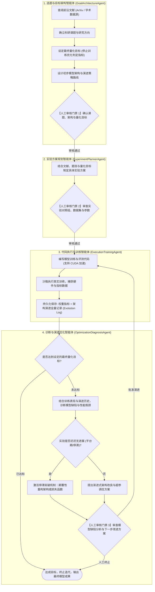

# Science4Me 项目目标与演进规划 (Project Goals & Architecture Evolution)

## 一、 项目定位与第一阶段核心目标

`Science4Me` 第一阶段聚焦于打造**以模型架构自主演进与实验训练为核心的人机协同科研引擎**。
彻底剥离初期的论文撰写、学术排版及盲审评阅等外围功能，集中攻坚**“选题与指标设定 -> 方案规划 -> CUDA代码执行与结果持久化 -> 模型诊断与架构演进优化”**的深度迭代闭环。

---

## 二、 第一阶段四大智能体架构与职责分工

---

## 三、 四大智能体详细规范

### 1. 选题与目标架构智能体 (`GoalArchitectureAgent`)
- **功能职责**：
  1. **文献检索**：基于输入方向检索 ArXiv 关联论文，提炼 SOTA 进展与技术短板。
  2. **课题选题**：形成明确的研究主题。
  3. **明确量化目标（Stopping Criterion）**：明确本次科研探索的**最终终止条件**（如：在特定验证集上准确率达到 95.0%、推理延迟降低 20%、或 Loss 降低至特定阈值），作为后续整个训练和优化闭环的停止判定标准。
  4. **初始架构与演进策略**：提出初步的模型架构设想，并规划梯队演进路线（如：第一代基础结构 -> 第二代动态调制 -> 第三代注意力强化）。
- **人工门禁 1**：研究者审核确认课题、停止目标与演进路线。

### 2. 实验方案规划智能体 (`ExperimentPlannerAgent`)
- **功能职责**：
  - 结合文献、选题与设定的量化目标，制定可落地执行的实验方案。
  - 确定数据集划分、基线对比（Baselines）、评价指标及训练超参数（Batch Size, Epochs, Learning Rate, Weight Decay）。
- **人工门禁 2**：研究者核验实验配置公平性与资源参数。

### 3. 代码执行与训练智能体 (`ExecutionTrainingAgent`)
- **功能职责**：
  - 编写自包含的 PyTorch 训练与验证代码，**显式调用 CUDA 算力硬件加速**。
  - 执行真实模型训练过程，具备异常自愈和重试能力。
  - **持久化保存全量资产**：
    - 实验评测指标文件（`metrics.json`）。
    - 实验运行日志（`train.log`）。
    - **架构演进记录（`evolution_history.json`）**：记录每一代模型的结构定义、参数量、每一轮的指标表现及架构变更点。

### 4. 诊断与演进优化智能体 (`OptimizationDiagnosisAgent`)
- **功能职责**：
  - **目标检测**：对照阶段 1 设立的最终量化目标，判定是否达成。达成则主动提示停止。
  - **瓶颈诊断**：未达成时，结合本轮训练数据（收敛速度、过拟合/欠拟合程度、梯度情况）及历史架构演进轨迹，深刻剖析模型缺陷与算力瓶颈。
  - **停滞突围机制（Stagnation Breakout）**：当检测到连续多轮指标无明显提升（进入鞍点或平台期）时，主动生成非渐进式的结构重构方案（如引入新激活机制、注意力重构、拓扑连接重塑）。
  - **提出改进方案**：给出明确的下一代架构变更细则与预期收益。
- **人工门禁 3**：研究者审核诊断结果与改进方案，决定是否“批准演进并启动下一代训练”或“人工终止”。

---

## 四、 后续阶段规划 (Out of Scope for Phase 1)
以下功能明确延后至第二、第三阶段，不在第一阶段过度设计：
- 学术论文起草与写作（LaTeX/Markdown）。
- 出版级论文配图与表格排版。
- 模拟会议同行盲审。
