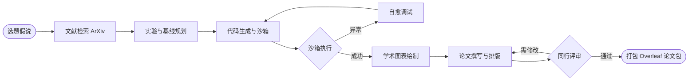

# Science4Me: 全自动科研与论文生成引擎 (Autonomous AI Scientist)

`Science4Me` 是一套专注于 **计算机科学与人工智能（AI/ML）领域** 的全自动科研与实验引擎。系统基于多智能体协作与 **LangGraph** 状态机编排，实现从初始课题输入到完整学术论文产出的全流程自主闭环。

---

## 🌟 核心特性与闭环流水线



1. **选题与前沿文献检索 (`IdeationAgent`)**：
   - 自动调用 ArXiv REST API 检索最新相关文献与 SOTA 基线。
   - 自动生成标准化 BibTeX 条目（`references.bib`）。
   - 构思具备创新性与可落地性的研究问题（RQs）与技术假说。
2. **实验方案规划 (`PlannerAgent`)**：
   - 设计自包含、高收敛性的工程实验基线与消融实验（Ablation Studies）。
   - 定义量化评价指标（Accuracy, Loss, Convergence Speed, FLOPs）。
3. **代码生成与沙箱自愈执行 (`CoderAgent` & `SandboxExecutor`)**：
   - 自动生成独立可运行的 PyTorch / ML 训练脚本 `experiment.py`。
   - 子进程隔离运行、硬件超时防护与指标监控。
   - **错误自愈（Self-Healing）**：自动捕获 Traceback 异常栈，分析原因并动态修复重试。
4. **出版级学术制图 (`VisualizerAgent`)**：
   - 自动绘制 300+ DPI 训练收敛曲线（Loss Curves）与基线对比柱状图。
   - 自动生成可直接插入论文的 LaTeX 统计对比表格（自动加粗最优数值）。
5. **多智能体学术论文撰写 (`WriterAgent`)**：
   - 模块化起草 Abstract、Introduction、Related Work、Methodology、Experiments、Conclusion。
   - 同步输出标准 LaTeX 源码包（`paper.tex`）与高可读 Markdown 版本（`paper.md`）。
6. **模拟顶会同行评审 (`ReviewerAgent`)**：
   - 按照 ICLR / NeurIPS 标准从健全性、创新性、实验充分度及表达清晰度进行 1-10 分打分。
   - 形成评审意见并驱动论文针对性修改优化。
7. **一键成果交付 (`ResearchExporter`)**：
   - 自动打包全部代码、数据、图表、BibTeX 与 LaTeX 源码为 `research_bundle.zip`，可直接上传至 Overleaf 或 ArXiv。

---

## 🚀 快速启动

### 1. 环境准备
确保已安装 Python 3.10+，并安装项目核心依赖：

```bash
pip install -r requirements.txt
```

### 2. 配置大模型 API（可选，系统内置稳健兜底模式）
编辑 `configs/config.yaml`，填入您的 API Key（支持 OpenAI、DeepSeek、Qwen、Ollama、vLLM 等兼容端点）：

```yaml
llm:
  api_key: "sk-xxxxxx"
  base_url: "https://api.openai.com/v1"
  model: "gpt-4o"
  temperature: 0.7
```
> 也可通过系统环境变量设置：`export OPENAI_API_KEY="sk-xxxxxx"`。如果未配置 API Key，系统会自动激活内置高质量科研算法样板，支持零成本离线完整跑通全流程！

### 3. 一键启动全自动科研

运行以下命令，启动一个全自动科研实验：

```bash
python main.py --topic "Adaptive Learning Rate and Feature Variance Modulation in Deep Neural Networks"
```

你也可以自定义任何感兴趣的 AI 研究方向，例如：
```bash
python main.py --topic "Attention Regularization with Gradient Harmonization for Transformer Training"
```

---

## 📂 项目结构说明

```text
science4me/
├── configs/
│   └── config.yaml           # 模型选择、API Key、超时、重试上限
├── science4me/               # 核心系统包
│   ├── engine/               # 工作流与状态机引擎
│   │   ├── state.py          # 全局科研状态 (ResearchState)
│   │   ├── llm.py            # 统一大模型调用客户端
│   │   └── workflow.py       # LangGraph 状态图编排器
│   ├── agents/               # 核心科研智能体
│   │   ├── ideation.py       # 选题与文献检索 Agent
│   │   ├── planner.py        # 实验规划 Agent
│   │   ├── coder.py          # 代码生成与自愈调试 Agent
│   │   ├── visualizer.py     # 学术制图与 LaTeX 表格 Agent
│   │   ├── writer.py         # 学术论文撰写 Agent
│   │   └── reviewer.py       # 模拟同行评审 Agent
│   └── tools/                # 支撑工具库
│       ├── academic_search.py# ArXiv API 文献检索与 BibTeX 转换
│       ├── sandbox.py        # 子进程安全沙箱执行器
│       └── exporter.py       # 论文与成果一键打包工具
├── workspaces/               # 运行时实验产物输出目录
├── requirements.txt          # 依赖声明
├── README.md                 # 项目介绍
└── main.py                   # 命令行启动入口
```

---

## 📄 成果产物示例 (`workspaces/run_xxx/`)

每次实验运行完成后，将在专属目录生成完整科研产物：
- `paper.md`：图文并茂的完整 Markdown 学术论文。
- `paper.tex`：标准 LaTeX 论文源码，包含公式与图表引用。
- `references.bib`：标准学术引用文献库。
- `experiment.py`：自主编写的完整可复现实验脚本。
- `metrics.json`：全量实验指标与收敛过程记录。
- `figures/`：生成的 300+ DPI 出版级科研矢量图表。
- `review.json`：模拟顶会同行评审专家打分与详细评语。
- `research_bundle.zip`：打包压缩包，可直接上传 Overleaf 编译为正式 PDF。
